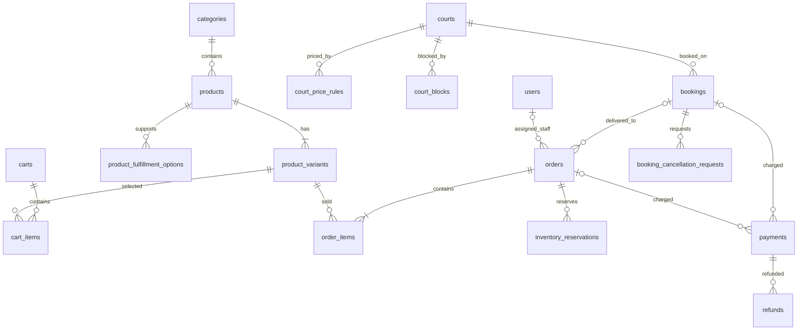

# Cơ sở dữ liệu

Nguồn schema là các migration V1–V7 trong `backend/src/main/resources/db/migration`.

`bookings` không có `booking_items`: mỗi phiếu là một sân. `orders.booking_id` chỉ dùng khi giao đến sân; tiền hàng vẫn nằm trong `orders`, không cộng vào tiền thuê sân. `payments` phải thuộc đúng một `booking_id` hoặc `order_id`, được kiểm tra khi tạo trong service. `guest_access_tokens` giữ bản băm token; API không trả danh sách phiếu theo điện thoại. Giá bán và giá thuê được chụp vào dòng đơn/phiếu khi tạo, không đổi theo giá hiện hành.
